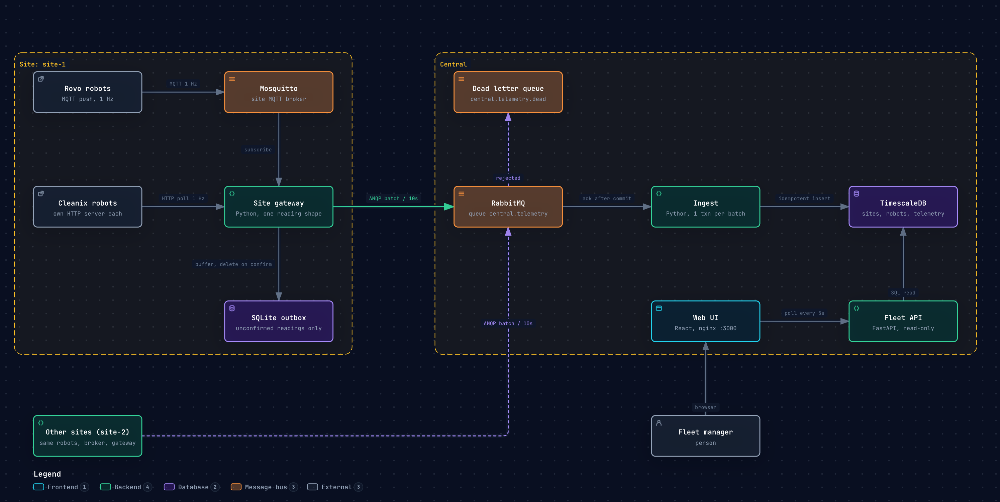

# Olivaw Fleet

Robots at several sites report their state once a second. This repo gets that data from each site to a central system, stores it and shows a fleet manager what the fleet is doing right now and what it did before.

All three parts of the brief are built and run with one command. Simulated robots from two vendors feed a gateway on each site, the gateway forwards every reading to central, and central stores it, derives health and serves a web UI.



For an interactive version you can zoom and trace paths in, open [architecture.html](architecture.html) in a browser.

## Run

Needs Docker with Compose.

```bash
make up
```

| What | Where |
|---|---|
| Web UI | http://localhost:3000 |
| Fleet API docs | http://localhost:8000/docs |
| RabbitMQ management, `olivaw` / `olivaw` | http://localhost:15672 |
| TimescaleDB | `localhost:5432`, or `make central-db` for psql |

Two sites start. `site-1` has 5 Rovo and 5 Cleanix robots, `site-2` has 3 and 2. The site page fills its charts as history builds up. `ROVO_COUNT` and `CLEANIX_COUNT` resize site 1, and the `CHAOS_*` rates in the [botsim README](simulator/botsim/README.md#config) make faults more frequent.

```bash
make test
```

That runs the Go and Python tests inside the service images, so nothing needs installing locally. The API tests need `central-db` running.

## What is in the repo

| Path | What | More |
|---|---|---|
| [simulator/botsim](simulator/botsim) | Go robot simulator. Two fictional vendors with different transports, units, enums and error codes, plus injected errors, stuck robots, dropouts and late readings. | [README](simulator/botsim/README.md) |
| [site/gateway](site/gateway) | Python service per site. Discovers robots, normalizes both vendors into one reading, buffers in SQLite and forwards to central. | [README](site/gateway/README.md), with how a reading reaches central |
| [central/ingest](central/ingest) | Consumes gateway batches and stores them in TimescaleDB, idempotently. | [README](central/ingest/README.md) |
| [central/api](central/api) | Read-only FastAPI service. Sites, robots with derived health, chart history. | [README](central/api/README.md), with how health is decided |
| [web](web) | React UI. Site dashboard, robot list, robot detail. | [README](web/README.md) |

## Why it is built this way

| Decision | Why |
|---|---|
| A gateway on every site | Robot protocols are local and differ per vendor, sites lose their uplink and central should not know vendor formats. The gateway is the one place a new vendor is added. |
| The gateway forwards every reading and analyses nothing | One message type, and every rule lives in one place at central. With a batch every 10s central sees any change within 10s, so detecting events on site would buy nothing. |
| SQLite outbox, delete only on publisher confirm | No database server at the edge. A 68s broker outage in testing lost no reading, the backlog drained oldest first once the link came back. |
| Site to central over RabbitMQ, dialed out from the site | Sites sit behind customer firewalls, so central never connects in. Publisher confirms make delivery at least once, and several ingest workers can share one queue. |
| Empty batches still go out | The batch doubles as the site heartbeat, and its header carries the backlog, so the UI can show a site as behind instead of silent. |
| Duplicates dropped on insert | A batch sent twice adds nothing, keyed on robot and timestamp. At least once plus an idempotent insert is effectively once. |
| TimescaleDB | Time series in plain SQL, with time buckets and 30 day retention built in. |
| Health derived per request, never stored | One SQL query in [health.py](central/api/health.py) holds every rule. Liveness is measured against what the site has delivered, so a site catching up on a backlog does not look like dead robots, and a dark site shows its robots as `unknown` instead of raising one alert per robot. |
| Polling, not push | Data lands every 10s, so a stream would not be fresher. Live views poll every 5s, charts about once per point and at most every 10s. |
| UI client generated from the API spec | Orval builds typed hooks from `openapi.json`, so the UI and the API cannot drift apart silently. |

## What is faked or left out

- **Robots.** Both vendors are fictional and simulated. Their wire formats are made different on purpose so normalization is real work.
- **Cleanix discovery.** The gateway finds Cleanix robots by resolving a Docker service name that returns every replica. A real site would scan the robot subnet or use a static list. Only `resolve()` in [cleanix.py](site/gateway/vendors/cleanix.py) would change.
- **Sites.** Both sites run on one Docker host and network. Each still has its own broker, gateway and robots and only reaches central over AMQP.
- **Commands.** Designed but not built. The plan is a durable queue per site, `site.{id}.commands`, consumed over the gateway's existing outbound connection, with a 60s expiry so a command never runs late and command ids remembered so a redelivery never runs twice. The robots in botsim already accept commands and the vendor command formats are in the [botsim README](simulator/botsim/README.md#wire-formats). Left out to spend the time on getting data in reliably and showing it well.
- **Positions.** Robots report positions in their own map frame. There are no floor plans, so the floor map just fits the points it gets.
- **Security.** No auth, no TLS, one shared demo user on RabbitMQ and plain text credentials in compose.

## With more time or in production

- **Commands** as designed above, with `POST /commands` for one or many robots answered `202` and a status per robot.
- **Auth and tenancy.** Users and roles on the API, per-site broker credentials and TLS on the uplink.
- **Faster "right now" queries.** A `robot_latest` table kept by ingest, so live views stop reading the newest row from the hypertable for every robot, plus a short response cache for many polling tabs.
- **Long history.** TimescaleDB compression and a 1 minute continuous aggregate, so week and month charts stop averaging raw readings.
- **Migrations** as their own step instead of ingest applying `schema.sql` at startup.
- **Alerts.** Notifications when a robot or site goes bad, instead of a manager watching the dashboard.
- **Real integrations.** Vendor SDKs, real discovery on the robot network, floor maps and elevator integration through the gateway.
- **Operations.** Metrics and tracing on the gateway and ingest, and the gateway shipped as a signed package that updates itself, since sites are hard to reach.
