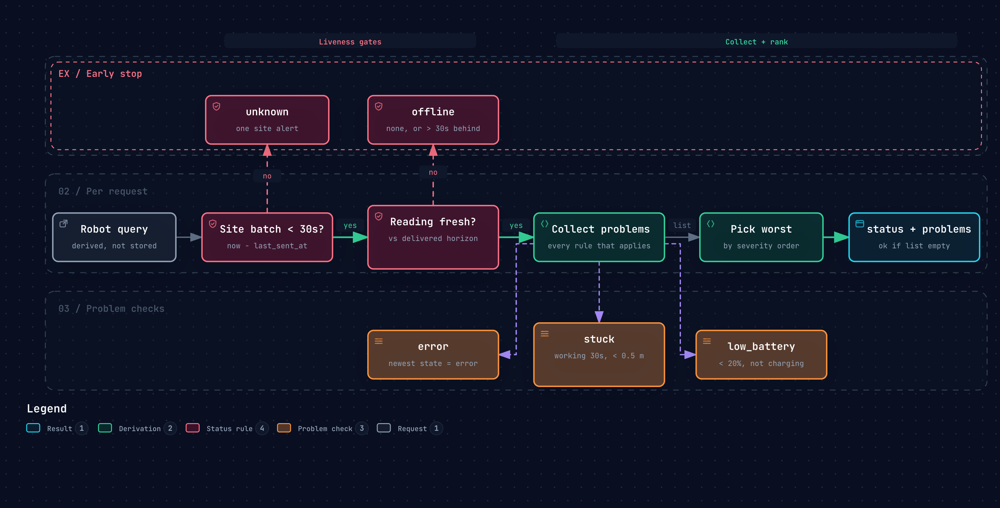

# Fleet API

Read-only FastAPI service over central TimescaleDB. It answers what every site and robot is doing right now and what they did before. Swagger is at http://localhost:8000/docs and the spec at `/openapi.json`, which the web UI generates its client from. Operation ids are the route function names, so the generated hooks read `useListRobots` or `useGetTelemetry`.

| Method | Path | Returns |
|---|---|---|
| `GET` | `/api/v1/sites` | Every site with its status and robot counts per health status and vendor |
| `GET` | `/api/v1/sites/{site_id}` | One site |
| `GET` | `/api/v1/sites/{site_id}/activity?period=` | How many robots were in each state per bucket, plus average battery, over the last `hour`, `day`, `week` or `month` |
| `GET` | `/api/v1/robots?site_id=&status=&vendor=&q=&limit=&offset=` | Robots with their newest reading and health, worst first, paginated. Repeat a filter to match any of its values. |
| `GET` | `/api/v1/robots/{robot_id}` | One robot |
| `GET` | `/api/v1/robots/{robot_id}/telemetry?period=` | Chart data for the last `hour`, `day`, `week` or `month`, or any `from`/`to` range up to 31 days |
| `GET` | `/health` | `ok` when the database answers |

Routes live in [sites.py](sites.py) and [robots.py](robots.py), the health rules in [health.py](health.py) and the response shapes in [models.py](models.py).

## Charts

Telemetry up to an hour comes back as raw readings. Longer ranges are averaged into buckets sized so a chart stays around 400 points. `bucket_s` in the response says how many seconds each point covers.

| Period | Bucket | Points |
|---|---|---|
| `hour` | raw | about 3600 |
| `day` | 5 min | 288 |
| `week` | 30 min | 336 |
| `month` | 2 h | 360 |

Robot details and chart data are separate calls on purpose. The UI refreshes details every few seconds and charts rarely, so a status poll never recomputes a month of averages.

## Health



Nothing is stored. It is derived on every request from the newest readings and each site's last batch. The thresholds are named constants at the top of `health.py`.

| Status | Rule |
|---|---|
| `unknown` | The robot's site sent no batch for 30s, so one site alert instead of one per robot |
| `offline` | No reading for 30s, or never. Measured against what the site has delivered, so a site catching up on a backlog does not look like dead robots. |
| `error` | The newest reading reports an error |
| `stuck` | Working for the last 30s by the robot's clock while moving under 0.5 m |
| `low_battery` | Under 20% and not already charging |
| `ok` | None of the above |

`problems` lists every status that applies and `status` is the worst. Sites are `offline` after 30s without a batch, `degraded` while readings still wait on site, `online` otherwise.

The UI polls every few seconds. Data lands every 10s, so a push stream would not make it fresher.

## Run

From the repo root.

```bash
docker compose up -d --build
```

```bash
curl -s localhost:8000/api/v1/robots
```

## Test

The tests run against a throwaway database on the running TimescaleDB, because the health rules are SQL.

```bash
make test-api
```
