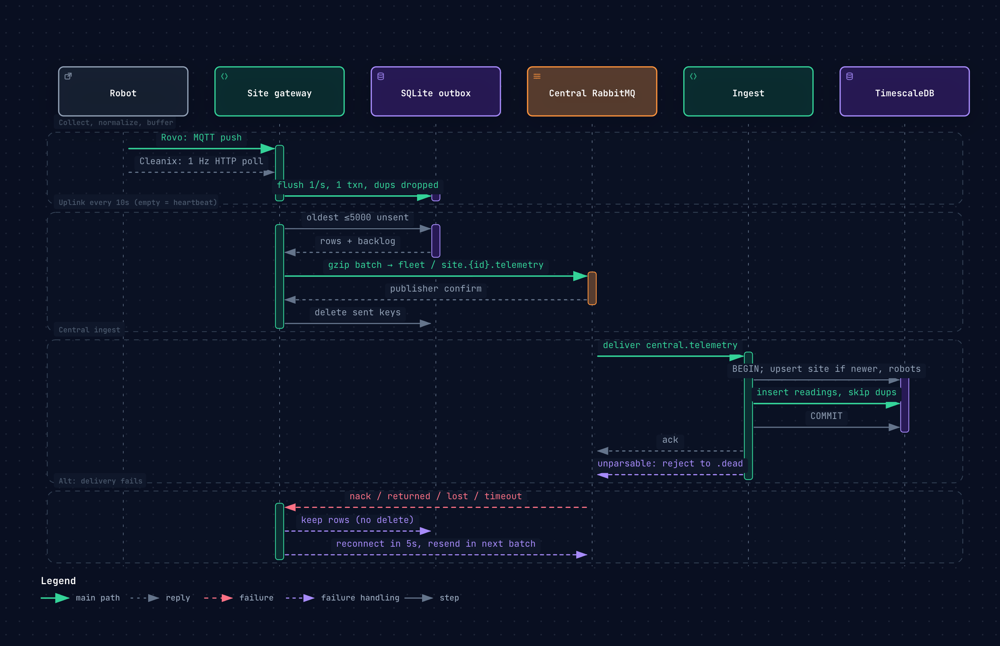

# site gateway

Runs on each site and is the only link between the site's robots and central. Central never talks to a robot directly.

- **Up.** Finds every robot on the local network whatever its vendor, translates each vendor's format into one canonical reading, keeps the history in SQLite and forwards it to central.
- **Down.** Takes commands from central, routes each to the right robot through its vendor adapter and reports the outcome back.

Built so far is discovery, normalization, local storage and forwarding to central. Executing commands comes next. The gateway does no analysis of its own. Central decides what counts as a problem.

Every vendor is one adapter in `vendors/`. An adapter knows how to discover that vendor's robots, how to get their data, how to map fields, units and enums and how to send them commands. Two adapters exist today. Their wire formats are in the [botsim README](../../simulator/botsim/README.md#wire-formats).

| Adapter | How the gateway gets data |
|---|---|
| Rovo | Subscribes to `rovo/+/telemetry` and `rovo/+/online` on the site broker. A new serial is a new robot. |
| Cleanix | Resolves `CLEANIX_DISCOVERY` every 30s (5s after a miss), probes `/api/v1/info` on each IP and polls `/api/v1/status` once a second. A robot that moves to a new IP keeps its serial and its stored IP is updated. |

Resolving a name to find Cleanix robots is a simulation stand-in. Docker DNS returns every replica of the compose service. A real site has no such name, so candidates would come from a subnet scan of the robot network or a static list of addresses. Only `resolve()` in `vendors/cleanix.py` would change, because probing and polling stay the same.

## Forwarding to central



Every `UPLINK_INTERVAL_S` the gateway sends one batch to central RabbitMQ with every reading central has not confirmed yet, so all 1 Hz readings and not just the newest. It sends a batch even when empty, so the batch doubles as the site heartbeat. The header carries how many readings are still waiting after this batch, 0 for a caught up site.

`robot_telemetry` only ever holds undelivered readings.

1. Take the oldest undelivered readings, up to `BATCH_LIMIT`.
2. Publish them and wait for RabbitMQ's publisher confirm.
3. On a confirm, delete exactly those readings. On any failure, keep them for the next batch.

During an outage readings pile up and drain oldest first once the link is back. If the confirm itself is lost a batch can go out twice, and central drops duplicates by robot and timestamp. Readings still undelivered after `RETENTION_HOURS` are dropped so a dead uplink cannot fill the disk.

| | Name |
|---|---|
| Exchange | `fleet` (topic) |
| Routing key | `site.{SITE_ID}.telemetry` |
| Queue central reads | `central.telemetry`, bound to `site.*.telemetry` so every site lands there |

The gateway only dials out. Central never connects into a site.

Central ingest logs every batch it stores, which is the quickest way to watch them arrive.

```bash
docker compose logs -f central-ingest
```

To add a vendor, write a module in `vendors/` with a `normalize()` that returns a `Reading` and a `run()` that discovers robots and feeds the store, then start it in `main.py`.

## Run

From the repo root.

```bash
docker compose up -d --build
```

## See what it stored

`show_state.py` prints what still waits for central and every robot the gateway knows, straight from SQLite. Run it inside the gateway container.

```bash
make gateway-state
```

That is the same as the following command.

```bash
docker compose exec site1-gateway python show_state.py
```

```
waiting for central: 49 readings, oldest 5.5s

robot       vendor   ip              last seen waiting
cx-260723   cleanix  192.168.147.8        1.2s       5
rv-14fa03   rovo     -                    1.0s       5
```

A healthy site waits on at most one interval of readings. A growing count means central is unreachable. `last seen` growing for one robot means that robot went quiet.

## Config

| Env | Default | |
|---|---|---|
| `SITE_ID` | required | Which site this gateway serves |
| `DB_PATH` | `/data/gateway.db` | SQLite file |
| `MQTT_HOST`, `MQTT_PORT` | required, 1883 | Site broker |
| `CLEANIX_DISCOVERY` | required | Name and port that resolve to Cleanix robots |
| `DISCOVERY_INTERVAL_S` | 30 | How often to look for new or gone Cleanix robots |
| `POLL_INTERVAL_S` | 1 | Cleanix status polling |
| `AMQP_URL` | required | Central RabbitMQ |
| `UPLINK_INTERVAL_S` | 10 | How often a batch goes to central |
| `BATCH_LIMIT` | 5000 | Readings per batch. A backlog drains in several. |
| `RETENTION_HOURS` | 24 | Undelivered readings older than this are dropped |

## Test

```bash
make test-gateway
```
